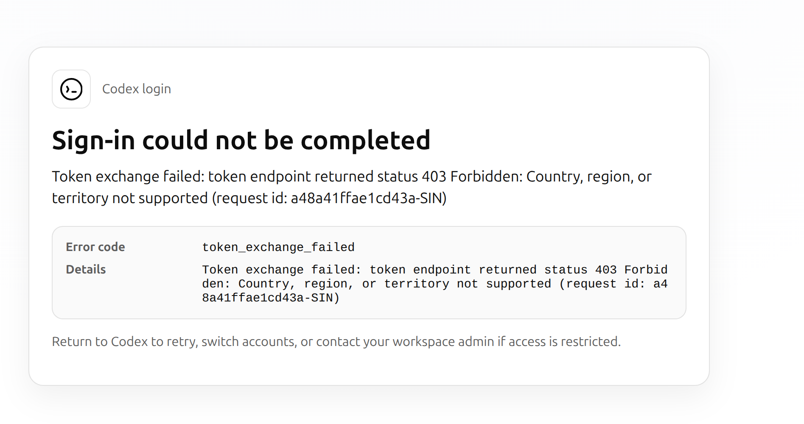

# Ubuntu 24.04：修复 ChatGPT 桌面端登录时的 token_exchange_failed 403

本文记录一次实际排障：Ubuntu 24.04 使用 Clash Verge 系统代理、未开启 TUN，ChatGPT 网页版可用，VS Code 中 Codex 可以完成新的认证，但 ChatGPT 桌面端登录失败。

**本案例的原因是桌面端认证后台没有获得代理环境变量。修复方法是为桌面端配置用户级启动器，让后台继承 Clash 的 HTTP 代理。** 这不是所有地区 403 的通用解决方案，应先用下文的对照实验确认。

## 1. 现象与适用范围

本次排障的原始错误截图：



浏览器显示 `Codex login`，错误内容为：

```text
Sign-in could not be completed
Token exchange failed: token endpoint returned status 403 Forbidden:
Country, region, or territory not supported
Error code: token_exchange_failed
```

本次环境：

| 项目 | 实际配置 |
| --- | --- |
| 操作系统 | Ubuntu 24.04，GNOME |
| 代理客户端 | Clash Verge / Mihomo |
| 代理模式 | 系统代理开启，TUN 未开启，规则模式 |
| 本机 mixed-port | `127.0.0.1:7892` |
| 桌面启动器 | `/usr/share/applications/chatgpt.desktop` |
| 应用入口 | `/usr/bin/chatgpt` |
| 桌面端后台 | `/usr/lib/chatgpt/resources/codex` |

不同安装包的文件路径和不同 Clash 配置的端口可能不同，操作前请核对。本文中的 `7892` 是本案例的真实端口，不是 Clash 的统一默认值。

## 2. 为什么网页和 VS Code 能登录，桌面端却失败？

浏览器授权与客户端交换令牌属于不同环节。浏览器可以使用 GNOME 系统代理，但客户端后台不一定读取这套设置。Clash 未开启 TUN 时，也不会仅凭“系统代理已开启”就接管所有进程。

本次读取正在运行的进程后，发现：

| 进程 | `HTTP_PROXY` / `HTTPS_PROXY` |
| --- | --- |
| 原 ChatGPT 桌面主进程 | 未设置 |
| 原桌面端 Codex 后台 | 未设置 |
| VS Code 的 Codex 后台 | 两者均为 `http://127.0.0.1:7892` |

VS Code 用户设置中还存在 `http.proxy`，与其后台实际获得的代理配置一致。决定性的证据来自下面的网络对照实验，而非仅凭配置推测。

> Clash 的“全局模式”控制进入 Clash 后的流量如何分流，不等同于所有应用流量都已进入 Clash。

## 3. 先诊断，再修改

### 3.1 检查系统代理和本机端口

```bash
gsettings get org.gnome.system.proxy mode
gsettings get org.gnome.system.proxy.http host
gsettings get org.gnome.system.proxy.http port
gsettings get org.gnome.system.proxy.https host
gsettings get org.gnome.system.proxy.https port
ss -ltn | rg ':7892\b'
```

本案例 HTTP 系统代理为 `manual`、`127.0.0.1`、`7892`。也应在 Clash 界面核对 HTTP 或 mixed-port；不要把 SOCKS 专用端口当作 HTTP 代理端口。

### 3.2 检查真正发起认证的进程

```bash
ps -eo pid,ppid,comm | rg -i 'chatgpt|codex|code|clash|mihomo'
```

对相关 PID 分别运行以下命令，将 `12345` 换成实际值：

```bash
readlink -f /proc/12345/exe
tr '\0' '\n' < /proc/12345/environ \
  | rg -i '^(http_proxy|https_proxy|all_proxy|no_proxy)='
```

没有输出表示这些变量未设置，或前一条读取命令失败；注意查看错误信息。应检查桌面端后台及 VS Code 后台，而不只是主进程。终端中运行 `env` 只能看到该终端的环境，不能证明从应用菜单启动的程序也有相同配置。

这些命令只筛选代理字段。不要公开完整进程环境、认证文件或含令牌的日志。如果代理 URL 含账号密码，分享前也应脱敏。

### 3.3 对比认证端点直连与代理响应

下面向认证端点发送空 JSON，不携带账号、授权码或令牌，也不尝试完成登录。

直连：

```bash
curl -sS --max-time 20 --noproxy '*' \
  -X POST 'https://auth.openai.com/oauth/token' \
  -H 'Content-Type: application/json' \
  -d '{}' -w '\nHTTP_STATUS=%{http_code}\n'
```

通过 Clash：

```bash
curl -sS --max-time 20 \
  --proxy 'http://127.0.0.1:7892' --noproxy '' \
  -X POST 'https://auth.openai.com/oauth/token' \
  -H 'Content-Type: application/json' \
  -d '{}' -w '\nHTTP_STATUS=%{http_code}\n'
```

本次结果：

| 路径 | HTTP 状态 | 响应内容 |
| --- | --- | --- |
| 直连 | `403` | `unsupported_country_region_territory` |
| 经 Clash | `400` | `Missing required parameter: 'grant_type'.` |

这里的 **400 是预期的诊断结果**：我们故意没有提交认证参数，服务端已进入参数校验，而不再返回地区限制。它证明当时两条网络路径的结果不同，但不代表完整 OAuth 登录已经成功，也不保证未来响应文本不变。

如果两种方式都返回地区限制，应继续检查 Clash 命中规则、实际出口和服务支持范围；不要直接套用本案例结论。若返回 `000`，应查看 curl 的连接、DNS 或 TLS 错误。

## 4. 修复：为 ChatGPT 创建用户级代理启动器

先核对应用入口和原始启动器：

```bash
command -v chatgpt
cat /usr/share/applications/chatgpt.desktop
```

本案例原始主入口是 `Exec=chatgpt %U`。下面脚本复制系统启动器到用户目录，只修改主入口，并备份已有用户级版本。它不会修改系统安装文件。

确认端口为 `7892` 后，在普通用户终端运行：

```bash
python3 - <<'PY'
from pathlib import Path
from datetime import datetime
import shutil

source = Path('/usr/share/applications/chatgpt.desktop')
target = Path.home() / '.local/share/applications/chatgpt.desktop'
text = source.read_text()
expected = 'Exec=chatgpt %U'
lines = text.splitlines()
if lines.count(expected) != 1:
    raise SystemExit('原启动入口与本案例不一致，请先检查文件，未进行修改。')

proxy = 'http://127.0.0.1:7892'
replacement = (
    'Exec=env '
    f'HTTP_PROXY={proxy} HTTPS_PROXY={proxy} '
    f'http_proxy={proxy} https_proxy={proxy} '
    'NO_PROXY=localhost,127.0.0.1,::1 '
    'no_proxy=localhost,127.0.0.1,::1 '
    '/usr/bin/chatgpt %U'
)
target.parent.mkdir(parents=True, exist_ok=True)
if target.exists():
    stamp = datetime.now().strftime('%Y%m%d-%H%M%S-%f')
    backup = target.with_name(f'chatgpt.desktop.backup-{stamp}')
    shutil.copy2(target, backup)
    print('原用户启动器备份：', backup)

target.write_text('\n'.join(replacement if line == expected else line
                            for line in lines) + '\n')
target.chmod(0o644)
print('已写入：', target)
PY
```

如已安装对应桌面工具，执行：

```bash
desktop-file-validate "$HOME/.local/share/applications/chatgpt.desktop"
update-desktop-database "$HOME/.local/share/applications"
```

`Categories` 包含多个主类别的 hint 不代表代理配置失败。这两个工具缺失时也不意味着启动器内容失效。

配置要点：

- 同时设置大小写代理变量，兼容不同网络库。
- `HTTPS_PROXY` 的值仍使用 `http://127.0.0.1:7892`，表示通过 HTTP 代理连接 HTTPS 目标，并未关闭 TLS 校验。
- `NO_PROXY` 保留 localhost、IPv4 和 IPv6 本机地址，供本地认证回调使用。如果原环境有额外必要的排除项，应合并保留。
- 保留 `%U`、图标、MIME 类型等原始启动器字段。
- 用户级同名启动器优先于系统启动器；应用更新后如果系统入口发生变化，应重新核对用户级副本。

## 5. 重启与验收

1. 保存正在进行的工作，从应用菜单正常退出 ChatGPT，确保旧后台退出。
2. 从 Ubuntu 应用菜单重新打开 ChatGPT。避免复用仍在运行、尚未继承新环境的旧实例。
3. 按第 3.2 节检查新的 Codex 后台，确认 `HTTP_PROXY`、`HTTPS_PROXY` 均为 `http://127.0.0.1:7892`。
4. 在桌面端重新发起登录，完成浏览器授权。不要只刷新旧的错误页。
5. 确认桌面端显示已登录，再进行一次正常使用验证。

如需从终端临时启动，可在旧实例完全退出后运行：

```bash
env HTTP_PROXY=http://127.0.0.1:7892 \
    HTTPS_PROXY=http://127.0.0.1:7892 \
    http_proxy=http://127.0.0.1:7892 \
    https_proxy=http://127.0.0.1:7892 \
    NO_PROXY=localhost,127.0.0.1,::1 \
    no_proxy=localhost,127.0.0.1,::1 \
    /usr/bin/chatgpt
```

用户级启动器只覆盖经该桌面入口的启动。直接执行裸 `chatgpt` 命令、其他快捷方式或已有自启动服务，不一定使用此配置。

**本次记录的验证边界：** 已完成直连/代理对照实验、安装启动器，并验证重启后的 Codex 后台继承了代理；整理本文时，尚未收到用户完成浏览器认证后的最终登录确认。因此本文不将完整登录标记为已验收。

## 6. 回滚

如果此前没有用户级启动器，将本次文件移出 `.desktop` 名称即可让系统入口重新生效：

```bash
mv "$HOME/.local/share/applications/chatgpt.desktop" \
   "$HOME/.local/share/applications/chatgpt.desktop.disabled-$(date +%Y%m%d-%H%M%S)"
update-desktop-database "$HOME/.local/share/applications"
```

如果此前有用户级版本，应改为把第 4 节打印的备份文件复制回 `chatgpt.desktop`。完成后正常退出并重新启动应用；已运行进程的环境变量不会随文件变化而自动更新。

## 7. 常见误区

- **网页可用，说明所有客户端都已走代理。** 实际应检查发起令牌交换的进程。
- **VS Code 新登录成功，所以桌面端也应成功。** 两者可能获得不同的代理配置，本案例正是如此。
- **必须开启 TUN。** 本案例通过应用级环境变量即可让认证后台使用代理，无需更改全机流量接管方式。
- **400 代表修复失败。** 空参数测试中，缺少 `grant_type` 的 400 是预期现象；正式认证仍需单独验收。
- **关闭证书校验能解决地区 403。** 本案例是服务端地区拒绝，修复没有使用 `curl -k` 或关闭证书验证。
- **错误 request ID 的机房后缀证明了出口地区。** 不能仅靠后缀判断用户出口 IP 的地区识别。
- **复制 VS Code 的认证文件是必要步骤。** 本次仅修复网络配置，没有复制令牌或修改账户凭证。

## 参考

- [OpenAI 官方认证说明](https://learn.chatgpt.com/docs/auth)：桌面端、CLI 和 IDE 扩展的浏览器登录流程，以及网页会话的区别。

本文主要结论来自本机进程环境与网络请求的实测，不能据此认定其他版本、系统或地区限制都有相同原因。
